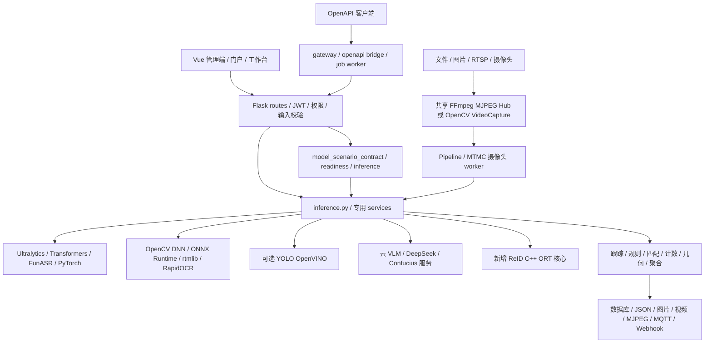
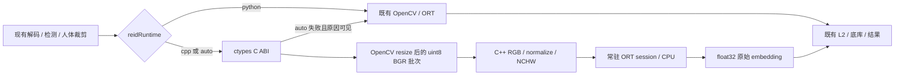

# TigerPro 项目推理架构与效率优化概述

2026-10-14 补充：跨镜车辆外观已接入共享 C++ ABI 2 核心，新增独立车辆运行时、模型选择、车辆阈值、匹配分差和同帧预算调度。精度对照与完整性能记录见 [车辆 C++ 版本说明](VEHICLE_CPP_RUNTIME.md)；默认仍保留原有运行时，原行人试点数字为 2026-10-13 的独立历史测量。

分析日期：2026-10-13。范围：当前工作区中的前端工作台、Flask 后端、所有业务推理服务、模型场景适配层、异步任务及视频流水线。本文依据代码审计；凡没有实测支持的性能结论均为待验证建议。

## 1. 总体结论

项目是「Vue 交互与视频展示 + Flask 业务编排 + 多种原生/深度学习运行时」的混合推理平台，而非单一 Python 计算引擎。模型运算主要已在 PyTorch、ONNX Runtime、OpenCV DNN、OpenVINO、sherpa-onnx 等底层执行。Python 的主要成本是串行编排、重复处理、数据转换、缓存/锁、跨模块重复推理及输出编码。

优先顺序建议：**先度量各阶段耗时与实际 provider，再控制重复推理和线程预算，再优化模型/量化与批处理，最后按收益迁移剩余热循环**。把接口或文件改写为 C++ 本身不能证明吞吐改善。

本次选择行人重识别和跨镜重识别进行增量试点：保留旧版，增加 `python/cpp/auto` 运行时选择；C++ 核心负责行人外观模型的预处理张量生成、ONNX Runtime CPU 推理和批量输出校验。检测、跟踪、底库、轨迹聚合、拓扑约束与身份关联继续使用现有服务。构建、使用和回滚见 [C++ 运行时部署说明](REID_CPP_RUNTIME.md)，实施边界见 [试点方案](REID_CPP_PLAN.md)。

## 2. 全局推理架构



### 2.1 入口与模型路由

- `backend/routes/ai_model.py`：传统检测、视频、分割、姿态、分类、文本、OCR、ASR、TTS、数字人及模型管理入口；按 `library/task/model_key` 分派。
- `services/model_scenarios.py`：注册 93 个模型场景，分组页面共用适配器；场景页面不代表独立神经网络。`model_scenario_contract.py`、`model_scenario_readiness.py` 校验能力/依赖/权重；`model_scenario_inference.py` 统一读入、执行与结果格式。
- `routes/reid.py`、`routes/mtmc.py` 等专用路由组合多个模型和业务状态，不只是模型的一次 forward。
- `routes/openapi_v1.py`、`gateway_app.py`、`services/openapi_handlers.py`、`openapi_bridge.py` 提供外部调用、任务与业务适配。应避免 HTTP 外层与内部函数分别解码同一媒体。

### 2.2 加载、缓存与并发现状

`inference.py` 使用 `BoundedCache`，默认每个模型族 2 个缓存条目，主 YOLO 缓存 4 个。YOLO 键含权重路径、mtime、推理后端、精度、输入尺寸等；多数 Transformers pipeline 缓存主要按任务和目录，目录中权重变化未必触发重载。全局 `_lock` 保护多个模型族的加载，重型冷加载可能阻塞无关任务的首次访问。

独立 DNN 文件（Youtu、MobileNet、LaMa、EfficientSAM）使用字典缓存，部分没有容量上限，旧 mtime 条目可能保留。Youtu、LaMa、EfficientSAM 的 OpenCV forward 用各自全局锁保护可变 Net，正确避免同 Net 的 setInput 竞争，但该文件所有模型/请求也被串行化。强行人 ReID 使用 CPU ORT 会话缓存；车辆 ReID 已有 4 会话 LRU、旧路径清理和权重哈希版本。

建议统一缓存生命周期接口，但不盲目统一执行对象：OpenCV Net/SAM predictor 等含可变状态，需要独立实例或完整调用锁；ORT 会话可在独立调用缓冲下并发。本次 C++ 核心以有界会话缓存、明确线程数、调用级缓冲实现后者。ORT 线程池/图优化可由 session options 调节；多会话默认线程池可能造成竞争，应测量整体资源预算。[ONNX Runtime 线程管理](https://onnxruntime.ai/docs/performance/tune-performance/threading.html)

### 2.3 视频和任务

`services/camera_stream.py` 的 `SharedMjpegHub` 将同源订阅共享为一个 FFmpeg 进程，支持断线重启和空闲释放。RTSP/设备路径先编码为 MJPEG，经 HTTP/订阅进入业务后又解码、推理、绘制和编码。MTMC 本地视频优先 `VideoCapture`，各摄像头 worker 按采样率处理；静态图也有专用路径。应分别度量 `decode/resize/infer/associate/draw/encode/network`，不要把处理 FPS、播放 FPS、源 FPS 混为一个指标。

管理端视频/训练/转换任务使用 `services/admin_jobs.py` 与持久 `job_store.py`、租约及 worker；MTMC 搜索仍有单独线程任务逻辑。`pipeline_runtime.py` 支持 inprocess/subprocess/cli，已有 infer 累计、掉帧及重连指标。多进程增加隔离性，也会复制模型内存；进程数应按模型资源而非 Flask worker 数直接扩张。

## 3. 各业务模块架构、瓶颈及建议

表中 P0 为应先度量/处理的吞吐或正确性问题，P1 为试点扩展后优先优化，P2 为按业务负载再投入。建议均应以质量回归作为约束。

| 模块 | 当前推理链路与关键实现 | 效率瓶颈与建议 | 优先级 |
|---|---|---|---|
| 通用目标检测、安防专用检测 | `inference.detect_image/detect_video` → Ultralytics；`.pt/.pth/.onnx`，可选同目录 ONNX 和 YOLO OpenVINO；业务模型覆盖火烟、PPE、安全帽、武器、打架、跌倒框、抽烟、手机、车牌、鱼、球、脑肿瘤等 | 首次 OpenVINO 导出/编译会混入请求；预先导出与预热。核对实际后端，按小目标大小调整 imgsz，避免无质量证据地全降到小尺寸 | P0 |
| 旧 YOLOv5 | `_load_legacy_yolov5_model`、专用检测；兼容权重和本地 hub | 兼容层/依赖分叉增加冷加载；固定已验证导出资产，避免首次在线补依赖 | P1 |
| HF DETR / OmDet | Transformers pipeline 或 processor + model；OmDet 接受文本类目 | PIL/BGR 转换、文本 token 重复生成和大模型前向；缓存不变类目 token，按设备策略部署，测量导出可行性 | P1 |
| ModelScope DAMO 检测 | `_get_ms_cv_pipe` → pipeline，图片/视频适配 | 视频逐帧调用及对象转换；固定本地资产，复用原始帧；先查 PyTorch 前向占比再决定 ONNX | P1 |
| RF-DETR 检测/实例分割 | `_get_rfdetr_model/_get_rfdetr_seg_model` → PyTorch + supervision 输出转换 | 模型前向、掩码物化与编码；按必要性输出 mask，部署已验证图；不能假定与 YOLO 的导出协议兼容 | P1 |
| YOLO-Master 检测/分类/姿态/OBB/分割 | `services/yolo_master.py` 注入第三方运行时、缓存模型、MoE 兼容修补 | 独立模型缓存和输出绘制；固定第三方版本，按任务单独比较，不套用普通 YOLO 的全部优化假设 | P1 |
| OBB 旋转框 | 场景适配 `_predict_objects`，Ultralytics/YOLO-Master 专用结果解读 | 旋转框转换及多边形绘制；原生 NMS/批量后处理可评估，须验证角度和顶点顺序 | P2 |
| 图像分类 / 实时分类 | MobileNet `mobilenet_dnn.py`（OpenCV→CPU ORT，FP/INT8）；ViT Transformers；YOLO-Master 分类 | 低负载可被 JPEG/PIL 开销主导；统一传 ndarray、减少重复编解码，比较批处理和量化 | P1 |
| YOLO/YOLOE 语义提示分割 | `segment_image_ultralytics`；YOLOE 动态设置类别，mask 输出 | 高频变类别会修改共享模型状态；按类目隔离实例/保护状态，限制 mask 编码与输出分辨率 | P1 |
| EfficientSAM 交互分割 | `efficient_sam_dnn.py` 多输入 ONNX，图像/点/标签 → OpenCV→CPU ORT | 每次点击可能重复图像编码；若模型可拆 encoder/decoder，缓存同图 encoder。其多输入图不能直接复用本次单输入 ReID 核心 | P1 |
| MobileSAM | `_get_mobile_sam_predictor` → mutable `SamPredictor` | 每次 `set_image` 的 encoder 成本；缓存图像 embedding，隔离同 predictor 的跨请求状态 | P1 |
| LaMa 图像修复 | `lama_dnn.py` 图像+mask 两输入，尺寸/掩码处理→OpenCV→CPU ORT | 大图前向和掩码缩放；按有效 ROI 修复并融合，验证接缝；不可直接复用单输入 ReID 接口 | P2 |
| 人体姿态 | YOLO pose；rtmlib RTMO/RTMPose/DWPose 单/双阶段 ORT，设备由运行设置解析 | 双阶段多人的逐裁剪 pose 前向、骨架绘制；检测共享、人体裁剪批量推理、按人数预算 | P0 |
| 手势 / 多手 / 手指数字 | `services/handpose.py` OpenCV palm→旋转手 crop→landmarks→几何分类；multi/video 包装 | 多手逐 ROI 网络与仿射处理；palm 低频检测、关键点跟踪补帧、ROI 批处理；共享模型状态需保护 | P1 |
| 中文手语识别 | `sign_language.py` YOLO 分类检测 + 可选掌检测、手区域裁剪/过滤 | 同帧多次检测与裁剪；复用掌/手轨迹，保持类名与左右手展示规则 | P1 |
| 跌倒检测 | `routes/fall.py` + `fall_detect.py`；框或姿态→关键点几何、NMS、跟踪→告警时序 | 模型推理通常重于几何；跟踪补帧、按真实时间去抖，减采样后不能保持原 confirm_frames 而不校准 | P1 |
| 深蹲计数 | `squat_sessions/video.py` 复用 COCO-17 pose；`squat_counter.py` 平滑→膝角→状态机→计数 | 主要成本在 pose；降低输入尺寸/ROI/采样必须回归动作漏计、时序确认和丢失宽限 | P1 |
| 羽毛球分析 | `badminton.py` 人体姿态 + 球检测 + 场地单应性 + rally/落点/轨迹/热力图 + H264 | 球小且快，不能统一降低全部 FPS；球采用高频、小 ROI/时序预测，人体用较低频，静态场地只初始化或变化时重算 | P1 |
| 球场角点检测 | `court_detector.py` 场地图像检测/几何定位供羽毛球复用 | 静态场地结果按视频缓存，移动相机按变化触发；本次不修改现有工作区的球场文件 | P2 |
| 普通目标跟踪 / 越线 / 区域计数 | `inference.track_frame/track_video` + `track_zone.py`，YOLO、tracker、轨迹/几何统计 | 重复检测和视频绘制；按源保持状态、按模型共享检测、检测与跟踪分频，验证 ID switch | P0 |
| 车辆分析、测速、拥堵、车牌 | `vehicle_track.py` 检车→轨迹→车牌框/pose→透视矫正→OCR候选→投票→速度/区域 | 单车多候选 OCR、多模型串行和 HUD；复用车牌质量采样、批量 rec、小 ROI；双线/比例测速必须保留标定 | P0 |
| 车辆 ReID | `vehicle_reid_feat.py` 单/多输入 ORT、模型哈希版本、有界缓存；2026-10-14 新增独立车辆 C++ ABI2 与同帧预算调度 | 颜色 fallback 质量弱，新 auto 模式禁止直方图进入身份原型；支持独立线程/batch控制。实测CLIP较准但更重，CPU C++与动态batch并非总更快，见车辆专项文档 | P1 |
| 人脸识别 / 底库 | `inference.extract_face_embeddings`；YuNet+SFace OpenCV 或 InsightFace SCRFD+ArcFace ORT→L2→底库 | 同图多脸逐项特征，重复检测；一次检测后批量 align/feature，ROI/质量门控。YuNet/SFace 缓存对象的 detect/feature 不在加载锁内，需核验并发可变状态 | P0 |
| 行人重识别（本次试点） | YOLO person→扩边 crop→Youtu 128×256 RGB/ImageNet→768维→L2→按模型/维度/版本匹配；近距可走人脸混合 | 原全局 DNN forward 锁、逐人转换、录像 query 重复计算；新增 C++ ORT 持久会话及独立识别/录像同帧批量调用。后续去除重复 query 计算和匹配热点需另测 | P0 |
| 跨镜重识别 MTMC（本次试点） | 各 camera worker→检测→ByteTrack/BoT-SORT/IoU→质量采样与预算→Strong/Youtu/车辆/车牌→Tracklet→拓扑/时间窗/分数融合→全局身份、候选及证据 | 多路检测与 ReID 争抢 CPU、同目标重复样本、关联/落库竞争；新增共享 C++ 人体特征核心，保留模型空间/版本、预算和关联策略。跨摄像头微批调度为后续，不在本次改造中 | P0 |
| 人员离岗检测 | `duty_absence.py` ByteTrack 检人→人脸/FAISS→冷却与 sticky→连续时间状态机 | 所有人每帧人脸会很重；已有冷却逻辑继续复用，身份稳定后降低再识别频率，断流暂停计时 | P1 |
| OCR 通用文字 | Transformers OCR→processor/decoder；RapidOCR PP det+rec→ONNX CPU | 文字检测、逐文本 crop/rec、格式转换；检测/识别批量化，车牌 rec-only 配置；线程按整体预算限制 | P0 |
| 表格结构识别 | `table_recog.py`/`inference.table_structure`：OCR→RapidTable SLANet→单元格/HTML | 重复 OCR、表格检测后的无关大图；共享 OCR 结果，表格 ROI，分开结构和文案识别耗时 | P1 |
| 水尺/水位 | `water_level.py` 可选 YOLO 尺区域→颜色/形态学/水面→多种放大增强 OCR→刻度插值 | 同图多轮 OCR 放大显著；早停于足够高质量刻度，缓存静态尺 ROI、批量候选，保留测量误差校验 | P1 |
| 缺陷诊断 | `defect_diagnosis.py` YOLO→低置信/疑似 ROI→云 Qwen-VL JSON→可选 mask→报告 | 网络往返、ROI base64 和多疑似对象调用；阈值/预算门控、同事件去重、限流和异步报告；云耗时不能归因本地 forward | P1 |
| 多模态定位 VLM-FO1 | `vlm_fo1.py` 可选 YOLO proposal + 本地模型/tokenizer/image processor→文本坐标解析 | `propose_boxes_yolo` 路径当前每次构造 YOLO，建议复用主缓存；proposal top-K/ROI、输入文本 token 复用、GPU dtype 与生成长度测量 | P1 |
| 云 Qwen-VL 分割/定位 | 场景适配→云视觉 API→掩码/框结果转业务格式 | 网络与图片上传；压缩合适尺寸、同图同 prompt 缓存、预算控制；独立统计云排队和服务耗时 | P1 |
| NLP 分类、情感、NER、QA | Transformers task pipeline + 模型目录 cache→tokenizer→模型→标签/实体/答案 | 单条短文本 Python/tokenizer 占比可能较高；token 批量、长度桶、padding 优化，小模型尝试 ORT/INT8 | P2 |
| NLP 零样本分类 | BART MNLI 将候选标签映射为多对文本→pipeline | 候选标签数放大前向量；预筛候选、复用模板 token、控制序列长度，验证多标签语义 | P1 |
| NLP 摘要、翻译、生成 | DistilBART/Opus 等 encoder-decoder/autoregressive pipeline | token 长度与逐 token 解码；明确 max input/output、批量和缓存，独立统计 tokens/s 与首 token 时间 | P1 |
| ASR SenseVoice/Paraformer | FunASR `AutoModel(device=cpu)`→generate；SenseVoice ONNX 专用路径 | 解码/重采样 + 声学网络，长音频串行；VAD/分段、缓存重采样、同长度批处理，评估 ONNX CPU | P1 |
| ASR Fun-ASR-Nano/Whisper/Moonshine | 特定加载与 dtype 兼容，Whisper pipeline/direct 备用，Moonshine processor/model | CPU autoregressive 解码，音频转换重复；减少 beam/无效生成、分块与有效上下文，记录 RTF/WER | P1 |
| ASR MOSS 转写/说话人 | `moss_mtd.py` 音频提取→processor→causal model.generate，支持推理模式与设备/dtype | 音频 token 长度、生成长度、前处理和说话人片段解析；按时长分块、限制 token，上 GPU 后核验 dtype/内存 | P1 |
| TTS Melo/MMS/VibeVoice/Piper | Melo sherpa-onnx；MMS Transformers；VibeVoice 第三方；Piper 本地下载 ONNX + onnxruntime 直载（四档） | 神经声码器/采样、音色加载；复用音色、文本句切、流式策略、缓存同文本，度量首音与 RTF | P1 |
| TTS VoxCPM2/NeuTTS 克隆 | `_get_voxcpm/_get_neutts`缓存；参考音频/文本→生成/codec；NeuTTS 额外 tokenizer/espeak/兼容修补 | 重复参考音频处理和初次 codec 资产准备；离线准备、参考 embedding 缓存、显式迭代数与内存预算 | P1 |
| 数字人 LinlyTalker | `synthesize_talking_head` 第三方脚本/子进程→音频/图像→视频 | 进程启动、重复模型加载、视频合成；固定专用 worker，常驻模型/身份模板，推理与编码分离 | P2 |
| RADAR 腹部 CT | `radar.py` real/mock 选择；real 载入第三方 3D 模型与文本编码器→NIfTI处理→CSV解析 | 3D 体数据内存、预处理、设备；复用权重、固定体素/ROI、独立队列。mock 是演示逻辑，不能统计为真实模型推理吞吐 | P1 |
| Confucius4 ASR/翻译 | `confucius.py` HTTP/WebSocket 连接独立服务；CPU GGUF 服务通过 `confucius_cpu*.py`按需启动 | 首次服务启动、模型加载、网络和自回归；服务预热、连接复用、限流，分离远程与 GGUF CPU 统计 | P1 |
| AI 报告 | `report.py`、`badminton_report.py`、`deepseek.py` 结构化统计→外部 LLM | 网络与 tokens；先本地压缩统计，缓存报告上下文，禁止在每帧上同步生成 | P2 |
| 告警引擎 | `alert_engine.py` 检测/轨迹→阈值、持续性、冷却与区域/越线规则 | 多规则重复取检测、共享状态锁；复用一次检测，按来源分片状态，用真实时间保持采样变化下语义 | P1 |
| 流水线 / 监控墙 / 屏幕 RTSP | `pipeline_runtime/schema/mtmc` 编排、门控 VLM、overlay、DB/MQTT/Webhook；共享流与 `screen_rtsp_push.py` | 推理与输出可能互相阻塞；有界队列、旧帧丢弃、输出异步、原始帧共享；慢消费者不能阻塞全路输入 | P0 |
| 模型管理/转换/训练/标注 | `model_convert.py` Ultralytics export/OpenVINO，`training.py` train/val/predict/export；dataset annotation/quality/convert | 不属于在线推理主链；与在线任务隔离 CPU/GPU，离线导出、验证及预热，避免训练挤占实时资源 | P1 |
| 权限/用户/部门/角色/菜单/门户/任务调度 | CRUD、JWT、配置、门户聚合、任务控制，无独立模型 forward | 数据库查询与序列化按普通 Web 服务优化；不得把此部分耗时计为模型加速收益 | P2 |

## 4. 行人重识别细化

### 4.1 原有链路与数据契约

`routes/reid.py` 的登记先解码照片，可使用检测器选最大人体并扩边裁剪，Youtu 特征 L2 后多图平均，写 `ReidEmbedding`。识别先检人，混合模式满足人脸尺寸/位置且匹配成功时使用人脸，否则使用外观。图库检索提取 query 后 Top-K；录像检索按 sample_fps 采样、逐人提特征、计算 query 余弦，必要时附带底库名字。

Youtu 默认输入为 `NCHW [1,3,256,128]`，RGB，`x/255`、ImageNet mean/std，输出通常 768 维（旧实现按实际输出记录维度）。原有优先 OpenCV DNN CPU，失败回退 ORT CPU。`latencyMs` 在张量预处理后计时，包含获取缓存/冷加载及 forward，不能直接与新路径包含 resize 的整体耗时比较。

底库缓存和匹配已按 `model_key + modality + dim + model_version` 隔离，NULL 历史版本单独处理。强模型空间与 Youtu 不得直接拼接/裁剪后当作同一语义特征；MTMC 已将多模型相似度按权重融合，并对可用权重重新归一化。

### 4.2 新增 C++ 版本



新增 C++ 调用只复制必要的 resize 后 batch 与输出，免去 JPEG/base64/HTTP IPC。RGB、归一化和 NCHW 在一次原生循环中完成；动态 batch 图可一次 Run，固定 batch=1 在 C++ 内循环，避免宣称固定图获得模型级批处理。独立识别会将待做外观的人体统一批处理，人脸已命中者不参加；录像检索在采样帧内批处理。

C++ 本身不计算底库匹配、不替换检测器，也不改变质量门控或相似度阈值。首次选择 C++ 要有原生库和匹配 ORT 运行库；`cpp` 失败可见，`auto` 回退可见。前端默认原有模式，升级部署不会无意改变所有现存推理行为。

## 5. 跨镜重识别细化

### 5.1 分层架构

1. **输入/检测**：各摄像头 worker 读取文件、图、流，按采样预算检人/车；同检测资产可共享一次检测结果的路径应持续保留。
2. **局部跟踪**：ByteTrack、BoT-SORT 或 IoU，保留 local id、trail、丢失恢复和可选 CMC。
3. **观测采样**：`TrackletBuilder`依据面积/置信度质量、时间间隔、视角/质量变化和 reid_budget 决定是否提特征；不需要每条轨迹每帧做 ReID。
4. **特征**：Strong（OSNet/CLIP/FastReID 风格单图 ONNX）与 Youtu 独立生成模型空间；车辆模型与车牌为另一套证据。
5. **聚合/关联**：轨迹保留模型/维度/版本键，按质量聚合，`MtmcAssociator`按拓扑、过境时间、候选/确认阈值、余弦分数和 margin 决策，保留短期 sticky、全局生命周期及长期 gallery。
6. **结果/证据**：全局 person/vehicle、candidate、association edge、跨镜事件、pass/tracklet 等持久化；运行时状态按镜头记录 actual provider、ready/degraded/error。

### 5.2 本次接入与下一步收益点

`MtmcConfig.reid_runtime` 与 API `reidRuntime`控制 Strong/Youtu 的特征提取；strong modelKey、Youtu modelKey、版本和分数融合保持一致。跨镜工作台显示 `onnxruntime-cpp-cpu`；`auto` fallbackReason 进入降级原因。并发 camera worker 可共享 ORT 会话，C++ 不使用全模型 forward 全局锁，缓冲互不覆盖。

接入多视频搜索时发现既有返回值契约不一致：录像推理返回 `hits`，任务聚合读取 `matches`，会丢失命中。试点将任务聚合改为读取 `hits`，并兼容旧 `matches`，同时返回按摄像头的运行时元数据；有独立回归测试覆盖这一链路。

行人 MTMC 仍沿用逐轨迹、按既有预算提取特征；2026-10-14 车辆扩展加入同帧采样调度，模型 batch 默认1，可按实际测量配置2/4等，不让多个镜头排队等待。后续若负载证明需要，可增加 **按模型空间汇总的短时微批队列**，以 5–10ms 等候窗起测；同时设置最大等待时间和丢弃策略。该方案会改变尾延迟，需以真实目标出现/离开事件及跨镜匹配回归作为门槛，不能仅测 crops/s。

关联阶段可能在全局候选增长后成为新瓶颈：先按 object type、模型版本、拓扑、时间窗预筛；再做同空间向量检索；最后保留颜色/车牌、互斥及业务规则。数据库批量写入与内存状态锁分离，但候选提升/合并必须保持事务一致性。不能为吞吐放松误合并限制。

## 6. 共性优化路线

### 6.1 P0：建立性能与质量基线

按任务/模型记录冷启动、热 p50/p95/p99、输入形状、精度、provider、线程、队列等待、有效 FPS、掉帧率、RSS/GPU 显存和失败/回退次数。`metrics_registry.py`当前 latency 用 count/sum，能算平均值而不能还原分位数；应增加 histogram 或离线完整样本。推理 API 的字段耗时起止不统一，必须明确时间范围。

实时路径测量：`T总 = T排队 + T解码 + T检测预处理 + T检测 + T裁剪 + TReID预处理 + TReID + T检索/关联 + T绘制/编码 + T落库/输出`。CPU 路径用 perf_counter；GPU 路径测量需考虑异步执行与同步点。不能用 UI 刷新频率充当模型吞吐。

质量指标分任务：检测 mAP/漏报；姿态关键点；OCR CER/车牌整串；ASR WER/CER；ReID Rank-1/mAP、检索排序；MTMC IDF1、ID switches、跨镜误合并/漏关联；计数漏计/重复计数。新增运行时首先验证 raw embedding/L2 后余弦/阈值附近判定一致，再验证实际身份质量。

### 6.2 P0：共享媒体与推理，控制队列

多个模块订阅同视频时，优先复用已解码帧和同模型同参数检测结果。当前共享 FFmpeg hub 降低了拉流进程重复，但仍可能有重复 JPEG decode 与业务模型 forward。用 `source + frameSeq + modelVersion + preprocessing/infer options` 构造短寿命结果键；模型/阈值变化不能复用过期结果。

实时任务采用最新帧优先的有界队列；离线任务应处理所有必要帧并明确降采样。把 MJPEG/视频编码、数据库/MQTT/webhook 作为独立输出消费；不让慢 Web 客户端放大实时推理延迟。后台异常需要可见、可恢复，不能把空结果当性能优化。

### 6.3 P1：模型和执行器

Intel CPU 比较现有 OpenVINO、ORT、OpenCV；NVIDIA 环境再测试 CUDA/TensorRT，不将 CPU/不同精度结果直接混算。模型管理已有 ONNX、OpenVINO、TensorRT/NCNN 导出能力，但「可导出」不意味着所有业务路径已验证该格式。

INT8 应按具体模型、输入与代表性校准集验证。ReID 中阈值附近距离变化可能造成身份错配，即使输出维度未变，也可能需要新的 modelVersion 与底库登记。FP16 在 CPU 上的收益也应实测；不把磁盘模型更小等同于计算更快。

合理线程预算取决于同时活跃会话/摄像头数和检测负载。官方支持会话线程及全局共享线程池；本次先使用每会话明确线程数、sequential 图执行、关闭无任务 spinning，后续以并发负载测量是否改用全局池。[ONNX Runtime C/C++ 部署与会话选项](https://onnxruntime.ai/docs/get-started/with-c.html)

### 6.4 P1：缓存及降级可观测性

统一权重版本键建议使用内容哈希（可按 mtime_ns/size 缓存哈希）；车辆模型已有这一模式，行人版本目前主要是文件名。调整版本协议属于迁移任务，需重新生成/隔离底库、轨迹和 gallery 缓存，不能本次静默改变历史数据。

冷加载按模型键同步，避免所有模型共享一把加载锁。按资源容量设置缓存，清除同资产旧版本。OpenCV Net/SAM predictor 等状态对象应锁完整状态操作或用实例池，不移除锁后直接并发；本次 ORT 原生路径的调用隔离通过真实并发测试验证。

自动 fallback 应记录 requested/effective runtime、原始错误和次数，重型加载失败可考虑按资产版本短期熔断，恢复后重新尝试。图推理、模拟演示、颜色直方图和云服务必须在监控中明确区分。

### 6.5 P2：服务分层演进

把检测/ReID/分割等常驻执行器与 Web 请求/事务分开，可统一 batching、GPU 内存及取消/背压；但独立服务增加序列化和运维成本。当前试点选择进程内 C ABI，以最小接口变化证明收益。只有在需要多语言、跨进程模型共享、专用 GPU 排队时再评估服务化。

## 7. 试点验收与实测记录

验收应包含：旧模式回归、严格模式缺库可见、自动模式回退可见、固定/动态 batch 真图一致性、非连续 ROI、并发、输入/输出约束、关闭生命周期、模型空间/版本隔离、前端构建，以及实际 Youtu 权重的性能对照。数字必须来自保存的基准 JSON；环境不同不能复用旧数字作为承诺。

### 7.1 验证记录

- Windows x64 原生库已用便携 Zig 0.13.0、ORT 1.20.1 头文件构建，产物 `backend/runtime/reid_cpp/reid_runtime.dll`，使用当前环境 ORT 1.27.0 动态库实际运行。Linux/macOS/MSVC 构建入口已提供，尚未在对应环境执行。
- 相关后端回归：**315 passed、1 skipped、1 deselected**。覆盖所有 `test_mtmc*.py`、新增原生/选择/回退测试、车辆 ReID 契约、模型场景及 OpenVINO 回归。原生测试在已构建 DLL 上执行，没有跳过；真实小型 ONNX 图验证固定/动态 batch、非连续 ROI、并发、关闭后调用、非法模型/ABI 缓冲，以及真实 MTMC 单帧特征/身份链路。录像和多图登记测试验证早先回退不被后续成功覆盖。
- 跳过项是环境未安装可选 `faiss-cpu` 的真实 FAISS 冷缓存测试，同链路的 fake FAISS 测试通过。
- 单独排除并记录 `test_route_ocr_callable_retains_configured_assets_without_claiming_ready`：其 fixture 使用 `ocr-det/ocr-rec`，不符合当前受控模型路径要求，`ocr_fn` 为 None。将 `HEAD` 版本 `routes/mtmc.py` 恢复到测试模块内复测也出现相同失败，属于既有基线问题；未放宽模型路径校验来绕过它。因此本记录不声称项目全量测试全部通过。
- 管理端 Vite 生产构建成功（2772 modules）；已有第三方 PURE 注解与大 chunk 提示。修改过的 Python 文件通过 compileall，工作区差异通过 whitespace 检查。

复验命令（项目根目录 PowerShell）：

```powershell
$mtmcTests = Get-ChildItem backend/unittests/test_mtmc*.py | ForEach-Object FullName
python -m pytest @mtmcTests backend/unittests/test_reid_cpp_runtime.py backend/unittests/test_vehicle_reid_contract.py backend/unittests/test_model_scenario_inference.py backend/unittests/test_openvino_cache_naming.py backend/unittests/test_openvino_unavailable_fallback.py -q -p no:cacheprovider -k 'not test_route_ocr_callable_retains_configured_assets_without_claiming_ready'
```

### 7.2 真实 Youtu 权重性能基准

环境：Windows 11 x64，Intel Family 6 Model 94，8 个逻辑 CPU；Python 3.13.5、OpenCV 5.0.0、ORT 1.27.0。模型 `person_reid_youtu_2021nov.onnx`，SHA256 `0579683334d4b9440221606dcb461656dd0dc64143b18f48faedaced9b4f580d`；动态 batch、float32、128×256。输入为固定随机生成的 283×139 BGR 裁剪，**不是带身份标签的准确率数据集**。三个模式依次运行，无本次测试/编译任务同时争抢 CPU。

旧路径实际使用 `opencv-dnn-cpu`，线程沿用现有默认；Python ORT 和 C++ ORT 均为 CPU、intra=2、inter=1、sequential、关闭 spinning。动态多图时两种 ORT 使用相同模型批策略（最多 64 张），避免把不同批策略当作语言收益。计时包含 resize/归一化/forward/输出；热延迟从线程实际开始调用算起，包含 forward 锁等待，不包含 executor 排队。吞吐包含执行期间线程池调度。

| 场景 | 模式 | 热 p50 每批 ms | 热 p95 每批 ms | 吞吐 crops/s |
|---|---|---:|---:|---:|
| 每批1人，1并发，30次，预热5次 | 旧 OpenCV | 63.85 | 67.76 | 15.47 |
| 同上 | Python ORT 调优 | 88.14 | 92.85 | 11.41 |
| 同上 | C++ ORT | 86.74 | 94.73 | 11.46 |
| 每批1人，4并发，40次，预热5次 | 旧 OpenCV | 252.20 | 390.86 | 15.52 |
| 同上 | Python ORT 调优 | 138.25 | 148.18 | 28.30 |
| 同上 | C++ ORT | 138.77 | 152.97 | 28.01 |
| 每批8人，4并发，20次，预热3次 | 旧 OpenCV | 1764.50 | 3520.14 | 13.91 |
| 同上 | Python ORT 调优（动态批） | 1141.13 | 1273.84 | 27.30 |
| 同上 | C++ ORT（动态批） | 1147.13 | 1284.26 | 27.19 |

**结论：** 相对旧路径，C++ 在 4 并发、每批1人时吞吐约 **1.80 倍**，每批8人约 **1.95 倍**；单并发单人吞吐反而约低 **26%**。同线程、同批策略的 Python ORT 与 C++ ORT 基本相当，不能把整体收益归因为 C++ 语言本身。多路行人特征负载可选择新版本，低并发单图应保留旧模式并按现场重测。

数值：三个场景 C++ 与 Python ORT 原始输出最大绝对差均为 0；与原 OpenCV 最大绝对差不超过 `4.1e-6`，余弦至少约 `0.99999988`，均满足脚本的 allclose 条件。单人单并发冷启动（会话创建+首次提取）约旧版 386.59ms、Python ORT 680.40ms、C++ 616.97ms；常驻复用才可获得热吞吐，频繁创建会话不划算。

原始可复核结果：[单人单并发](benchmarks/bench-b1.json)、[单人4并发](benchmarks/bench-b1-w4.json)、[8人4并发](benchmarks/bench-b8-w4.json)。脚本 `backend/scripts/benchmark_reid_cpp.py` 可按部署环境重跑；启用和命令见 [部署说明](REID_CPP_RUNTIME.md)。

### 7.3 未覆盖项与扩展门槛

本次没有真实 Strong 人体权重、标注 ReID/MTMC 数据集、GPU 或生产多路视频质量基线。Strong 的接口空间隔离和原生通用图执行已验证，但其真实权重速度、Rank-1/mAP、IDF1、误合并率及端到端 FPS **未测**。不将特征吞吐提升外推为整个 MTMC 的等比例提升。下一轮应先保存同一视频集的旧版和新版分段耗时与身份事件，再决定设备 provider、微批队列或更多模块迁移。

## 8. 代码定位索引

| 责任 | 主要文件 |
|---|---|
| 通用模型执行 | `backend/inference.py`、`backend/onnx_compat.py` |
| 场景能力/入口 | `services/model_scenarios.py`、`model_scenario_contract.py`、`model_scenario_readiness.py`、`model_scenario_inference.py` |
| DNN 单任务核心 | `person_reid_dnn.py`、`mobilenet_dnn.py`、`efficient_sam_dnn.py`、`lama_dnn.py`、`yunet_sface.py` |
| 原生试点 | `native/reid/src/reid_runtime.cpp`、`native/reid/include/reid_runtime.h`、`services/reid_cpp.py`、`services/reid_runtime.py` |
| ReID 业务与底库 | `routes/reid.py`、`models/reid.py`、`services/reid_gallery.py`、`services/strong_reid.py` |
| MTMC | `routes/mtmc.py`、`services/mtmc_engine.py`、`mtmc_local_track.py`、`mtmc_tracklet.py`、`mtmc_associator.py`、`mtmc_active_gallery.py`、`mtmc_persist.py`、`mtmc_search.py` |
| 视频与流水线 | `services/camera_stream.py`、`pipeline_runtime.py`、`pipeline_schema.py`、`pipeline_mtmc.py`、`screen_rtsp_push.py` |
| 姿态/动作/规则 | `services/handpose*.py`、`fall_detect.py`、`squat_counter.py`、`squat_sessions.py`、`squat_video.py`、`badminton.py`、`court_detector.py`、`sign_language.py`、`alert_engine.py` |
| 行车/离岗/测量 | `services/vehicle_track.py`、`vehicle_reid_feat.py`、`track_zone.py`、`duty_absence.py`、`duty_faiss.py`、`water_level.py`、`table_recog.py` |
| 大模型/语音/CT | `services/vlm_fo1.py`、`defect_diagnosis.py`、`moss_mtd.py`、`confucius*.py`、`radar.py`、`radar_real.py`、`backend/deepseek.py`、`report.py` |
| 管理/资源/任务 | `services/bounded_cache.py`、`model_paths.py`、`model_convert.py`、`training.py`、`dataset_*.py`、`admin_jobs.py`、`job_store.py`、`metrics_registry.py`、`object_store.py` |
| 外部 API | `gateway_app.py`、`routes/openapi_v1.py`、`services/openapi_handlers.py`、`openapi_bridge.py`、`openapi_catalog.py` |
| 前端试点 | `frontend/frontend_admin/src/views/ai/reid/index.vue`、`frontend/frontend_admin/src/views/ai/mtmc/index.vue` |

## 9. 模型场景适配器清单

以下清单从 `services.model_scenarios.list_scenarios()` 生成，对注册场景逐一覆盖。相同适配器复用第 3 节对应推理架构与优化策略；传统模型管理允许用户新增模型，因此该注册表不代表数据库中全部自定义资产。

| 模型 key | 名称 | 适配器 | 能力 |
|---|---|---|---|
| efficient-sam | EfficientSAM-Ti（OpenCV） | efficient_sam | interactive-segmentation |
| mobile-sam | MobileSAM 交互分割 | mobile_sam | interactive-segmentation |
| clip-reid-vehicle | CLIP-ReID Vehicle | vehicle_reid_onnx | vehicle-reid |
| keremberke-yolov5m-license-plate | 车牌检测 YOLOv5m（keremberke） | ultralytics_detection | plate-detection |
| keremberke-yolov5n-license-plate | 车牌检测 YOLOv5n（keremberke） | ultralytics_detection | plate-detection |
| transreid-vehicle | TransReID Vehicle | vehicle_reid_onnx | vehicle-reid |
| vehicle-vit-reid | Vehicle ViT ReID | vehicle_reid_onnx | vehicle-reid |
| yolo26n-obb | YOLO26n 旋转框 OBB | ultralytics_obb | obb |
| yolo26n-p2-plate | 车牌检测 YOLO26n-P2（自训脚手架） | ultralytics_detection | plate-detection |
| yolo26n-plate | 车牌检测 YOLO26n（CodexParas） | ultralytics_detection | plate-detection |
| yolo26s-plate-pose | 车牌四点 YOLO26s-pose（推荐·透视） | ultralytics_pose | plate-pose |
| yolov11-license-plate-n | 车牌检测 YOLOv11n（推荐·CPU） | ultralytics_detection | plate-detection |
| yolov11-license-plate-s | 车牌检测 YOLOv11s（推荐·精度） | ultralytics_detection | plate-detection |
| yolov8-license-plate | 车牌检测 YOLOv8（Koushim） | ultralytics_detection | plate-detection |
| insightface-buffalo-l | InsightFace Buffalo-L | face_recognition | face-recognition |
| insightface-buffalo-s | InsightFace Buffalo-S | face_recognition | face-recognition |
| opencv-yunet-sface | OpenCV YuNet+SFace | face_recognition | face-recognition |
| brain-tumor-yolo-opennoor | 脑肿瘤医学影像检测（OpenNoorIlm） | ultralytics_detection | object-detection |
| inpainting-lama | LaMa 图像修复（OpenCV） | opencv_lama | image-inpainting |
| mobilenet-v2 | MobileNet V2（OpenCV DNN） | opencv_dnn_classify | image-classification |
| vit-base | ViT 通用图像分类 | transformers_classify | image-classification |
| yolo-master-cls-n | YOLO-Master Cls-N 图像分类 | yolo_master_classify | image-classification |
| vlm-fo1-3b | VLM-FO1 3B（多模态定位/REC） | vlm_fo1 | multimodal-grounding |
| dwpose-m | DWPose-M 全身姿态 | rtmlib_pose | body-pose |
| rtmo-m | RTMO-M 姿态估计 | rtmlib_pose | body-pose |
| rtmo-s | RTMO-S 姿态估计 | rtmlib_pose | body-pose |
| rtmpose-m | RTMPose-M 姿态估计 | rtmlib_pose | body-pose |
| yolo-master-pose-n | YOLO-Master Pose-N 姿态估计 | yolo_master_pose | body-pose |
| yolo11n-pose | YOLO11n 姿态估计 | ultralytics_pose | body-pose |
| yolo26n-pose | YOLO26n 姿态估计 | ultralytics_pose | body-pose |
| ppe-detection | PPE穿戴识别 | ultralytics_detection | object-detection |
| damoyolo-cigarette | 实时香烟检测-通用 | modelscope_detection | object-detection |
| sec-fall-coco-yolov12m | 通用检测 COCO80（YOLOv12m·安防包） | ultralytics_detection | object-detection |
| sec-fall-yolo11n | 跌倒/行为检测（YOLO11n·7类） | ultralytics_detection | object-detection |
| sec-fight-nano | 打架检测-轻量（YOLO nano） | ultralytics_detection | object-detection |
| sec-fight-small | 打架检测（YOLO small） | ultralytics_detection | object-detection |
| sec-fire-collision-yolo11 | 碰撞/灾害/烟火检测（YOLO11n·88类） | ultralytics_detection | object-detection |
| sec-fire-forest-yolov8 | 森林火灾检测（YOLOv8s） | ultralytics_detection | object-detection |
| sec-fire-yolov8n | 烟火检测-轻量（YOLOv8n） | ultralytics_detection | object-detection |
| sec-helmet-yolov8s | 安全帽/防护装备检测（YOLOv8s·18类） | ultralytics_detection | object-detection |
| sec-plate-yolov8 | 车牌检测（YOLOv8n·安防包） | ultralytics_detection | plate-detection |
| sec-ppe-yolo | PPE 安全装备检测（YOLO） | ultralytics_detection | object-detection |
| sec-weapon-yolov8 | 武器检测（YOLOv8·枪/刀） | ultralytics_detection | object-detection |
| yolo26-smoking-detection | 吸烟行为检测（YOLO26s） | ultralytics_detection | object-detection |
| yolo8-smoking-behavior | 吸烟行为多类检测（YOLOv8） | ultralytics_detection | object-detection |
| yolov8n-mobile-phone | 手机使用检测（YOLOv8n） | ultralytics_detection | object-detection |
| bert-ner | BERT 命名实体识别 | transformers_ner | token-classification |
| rf-detr-seg-medium | RF-DETR Seg Medium 实例分割 | rfdetr_seg | instance-segmentation |
| yolo-master-seg-n | YOLO-Master Seg-N 实例分割 | yolo_master_seg | instance-segmentation |
| yoloe-26s-seg | YOLOE-26s 开放词汇分割 | ultralytics_seg | instance-segmentation |
| qwen3-vl-seg-cloud | Qwen3-VL-Seg 云端诊断（说明） | qwen_vl_api | industrial-diagnosis |
| omdet-turbo-swin-tiny | OmDet-Turbo Swin Tiny（开放词汇检测） | omdet_detection | open-vocab-detection |
| chinese-sign-language-tigerhhzz-yolo11s | 中国手语识别（YOLO11s·tigerhhzz） | ultralytics_detection | object-detection |
| opencv-handpose-mediapipe | 手部关键点估计（MediaPipe·OpenCV） | opencv_handpose | hand-pose |
| linly-talker | Linly-Talker 数字人 | linly_talker | talking-head |
| bert-emotion | BERT 情绪识别 | transformers_text_classify | text-classification |
| finbert | FinBERT 金融情感分析 | transformers_text_classify | text-classification |
| bart-mnli | BART 零样本分类 | transformers_zero_shot | zero-shot-classification |
| bert-fill-mask | BERT 完形填空 | transformers_fill_mask | fill-mask |
| distilbart-cnn | DistilBART 文本摘要 | transformers_summarize | summarization |
| opus-mt-en-zh | Opus 英译中 | transformers_translate | translation |
| PP-OCRv6_tiny_det_onnx | PP-OCRv6 tiny 检测（边缘） | rapidocr_det | document-ocr |
| PP-OCRv6_tiny_rec_onnx | PP-OCRv6 tiny 识别（边缘） | rapidocr_rec | document-ocr |
| PP-OCRv6_small_det_onnx | PP-OCRv6 small 检测（推荐） | rapidocr_det | document-ocr |
| PP-OCRv6_small_rec_onnx | PP-OCRv6 small 识别（推荐） | rapidocr_rec | document-ocr |
| PP-OCRv6_medium_det_onnx | PP-OCRv6 medium 检测（高精度） | rapidocr_det | document-ocr |
| PP-OCRv6_medium_rec_onnx | PP-OCRv6 medium 识别（高精度） | rapidocr_rec | document-ocr |
| rapidtable-slanet-plus | SLANet_plus 表格结构 | rapidtable | document-ocr |
| yolov8m-table-extraction | 文档表格检测 | ultralytics_detection | document-ocr |
| yolo-master-obb-n | YOLO-Master OBB-N 旋转框检测 | yolo_master_obb | obb |
| distilbert-squad | DistilBERT 抽取式问答 | transformers_qa | question-answering |
| yolo11-fish-detector-grayscale | 鱼类检测（灰度水下·YOLO11n） | ultralytics_detection | object-detection |
| fire-smoke-detection | 烟雾探测 | ultralytics_detection | object-detection |
| yolo11s-ball | YOLO11s 羽毛球检测 | ultralytics_detection | object-detection |
| rocket-detect-nasaspaceflight | 火箭回收跟踪检测（NASASpaceflight） | ultralytics_detection | object-detection |
| clip-reid-person | CLIP-ReID Person（强） | person_reid_onnx | person-reid |
| opencv-person-reid-youtu | OpenCV Youtu Person ReID | person_reid_onnx | person-reid |
| osnet-x1-0 | OSNet x1.0 Person ReID（强） | person_reid_onnx | person-reid |
| melotts-zh-en | MeloTTS 中英混合合成 | sherpa_tts | text-to-speech |
| piper-x_low | Piper TTS x_low（极速） | piper_tts | text-to-speech |
| piper-low | Piper TTS low（快速） | piper_tts | text-to-speech |
| piper-medium | Piper TTS medium（推荐） | piper_tts | text-to-speech |
| piper-high | Piper TTS high（高音质） | piper_tts | text-to-speech |
| mms-tts-eng | MMS-TTS 英文语音合成 | transformers_tts | text-to-speech |
| vibevoice-realtime | VibeVoice 实时语音合成 | vibevoice_tts | text-to-speech |
| fun-asr-nano | Fun-ASR-Nano 语音识别 | funasr_nano | speech-recognition |
| moonshine-tiny | Moonshine Tiny 语音识别 | transformers_asr | speech-recognition |
| moss-transcribe-diarize-0p9b | MOSS-Transcribe-Diarize 0.9B（多人识别+时间戳） | transformers_asr | speech-recognition |
| paraformer-zh | Paraformer 中英语音识别 | funasr | speech-recognition |
| sensevoice-small | SenseVoice 语音识别 | funasr | speech-recognition |
| sensevoice-small-onnx | SenseVoice 语音识别(onnx量化) | funasr_onnx | speech-recognition |
| detr-resnet-50 | DETR 通用目标检测 | transformers_detection | object-detection |
| rf-detr-medium | RF-DETR Medium 目标检测 | rfdetr_detection | object-detection |
| yolo-master-esmoe-n | YOLO-Master EsMoE-N 检测 | yolo_master_detect | object-detection |
| yolo-master-esmoe-s | YOLO-Master EsMoE-S 检测 | yolo_master_detect | object-detection |
| yolo-master-v01-n | YOLO-Master v0.1-N 检测 | yolo_master_detect | object-detection |
| yolo26n | YOLO26n 通用检测 | ultralytics_detection | object-detection |
| yolo26s | YOLO26s 通用检测 | ultralytics_detection | object-detection |
| radar-abdominal-ct | RADAR 腹部 CT 诊断 | radar | abdominal-ct-diagnosis |
| confucius4-r2t2 | Confucius4-R2T2 流式语音识别 | confucius_r2t2 | speech-recognition |
| confucius4-t3po | Confucius4-T3PO 中英同传翻译 | confucius_t3po | translation |
